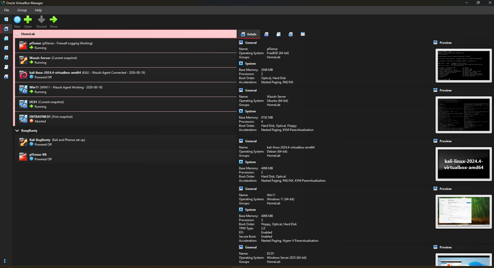
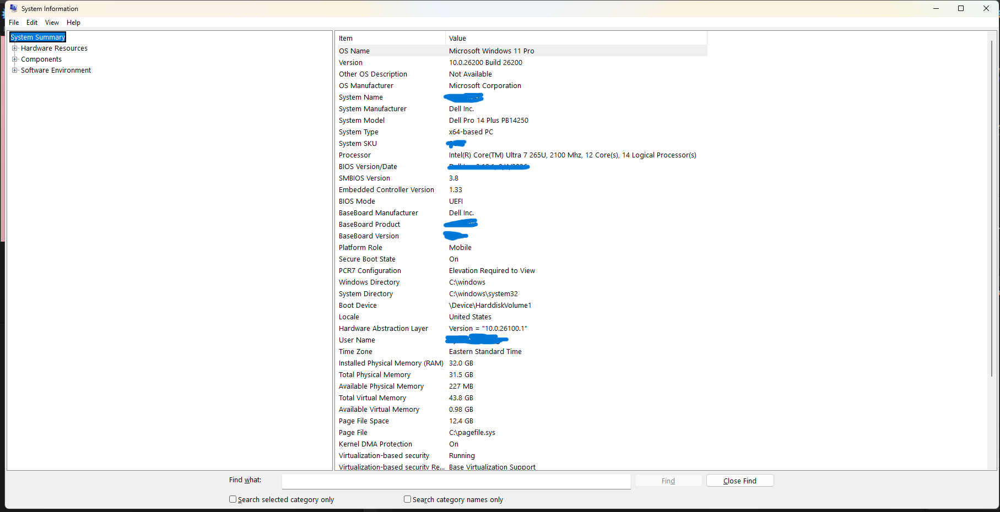
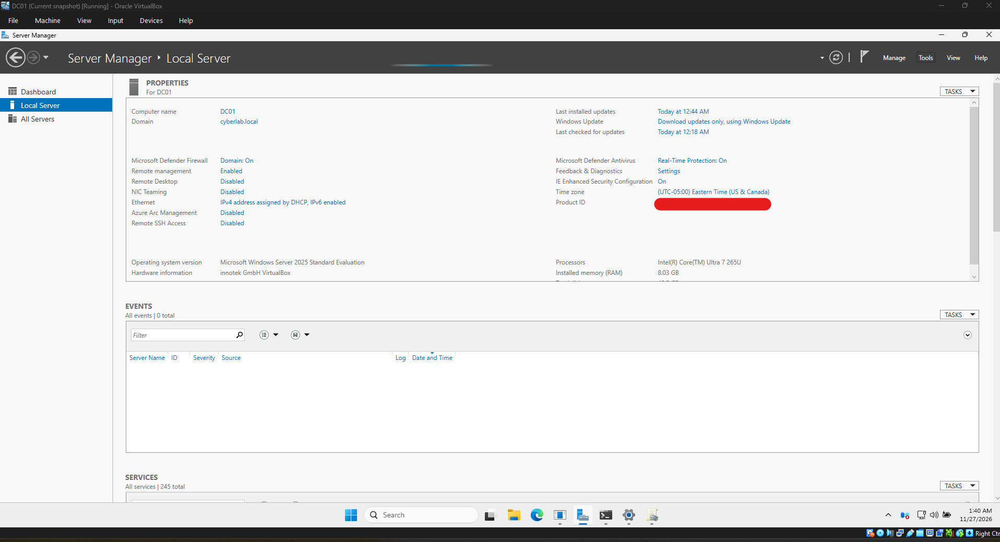
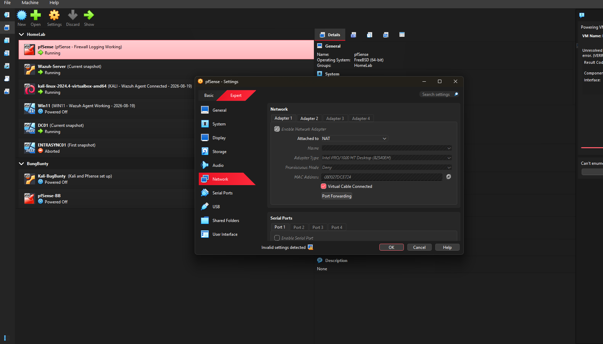
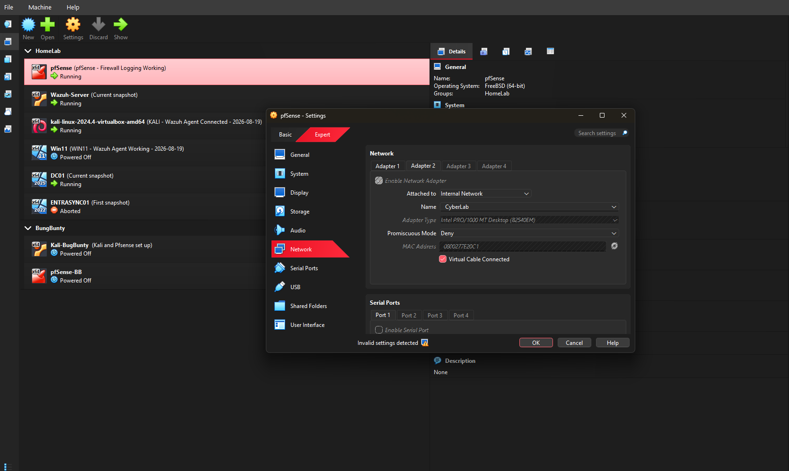
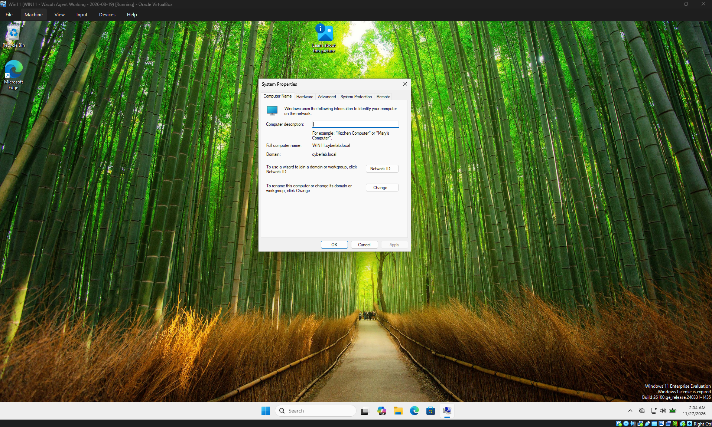
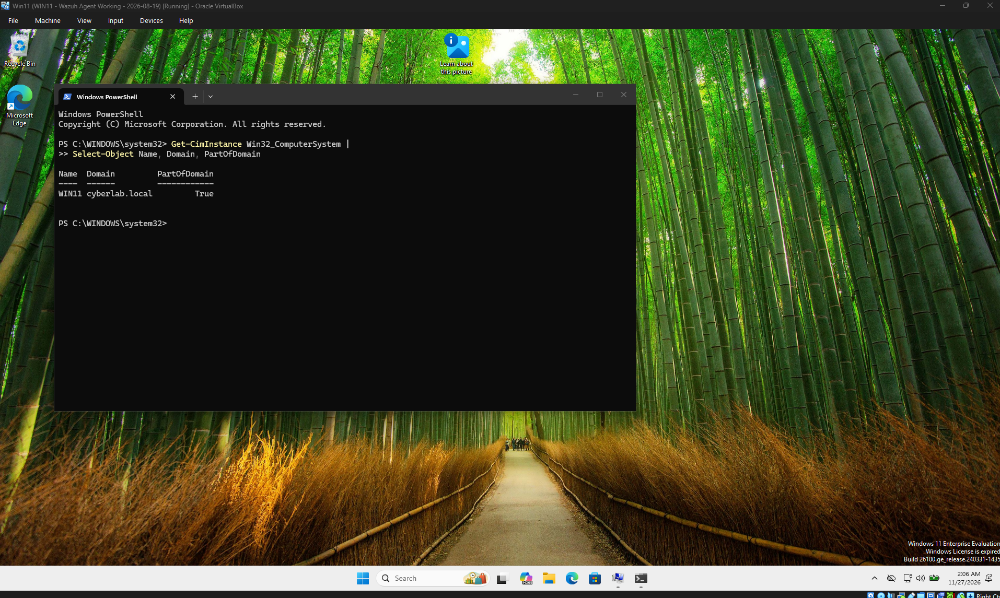
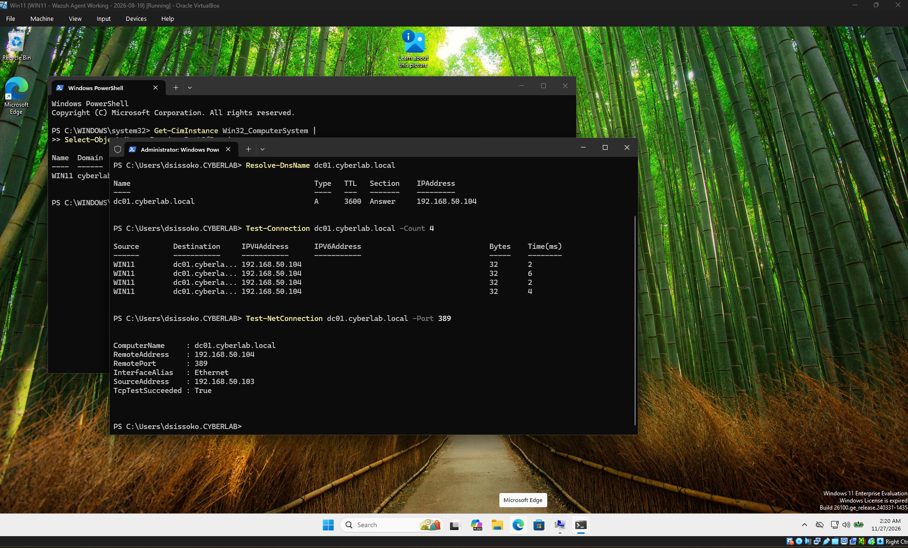
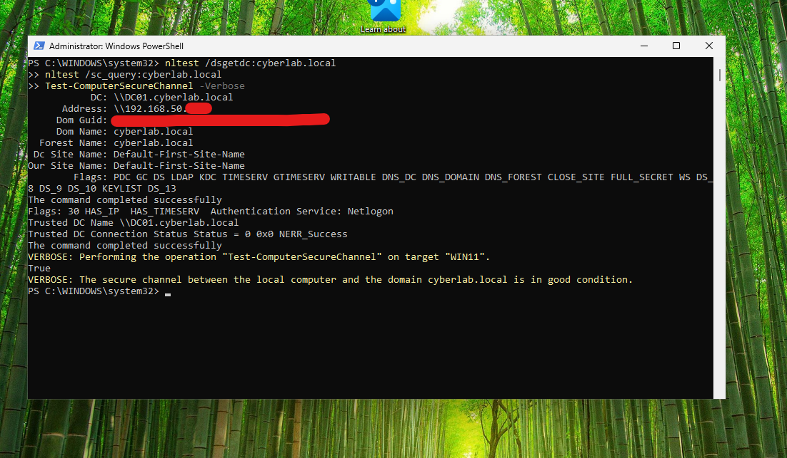
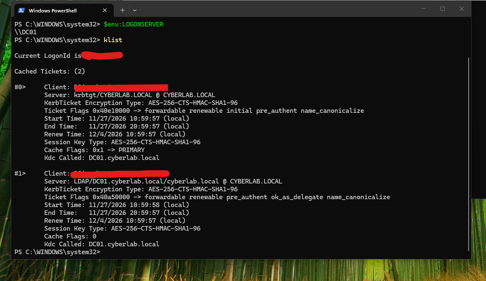

# Enterprise Infrastructure Deployment

## Project Overview

Designed and deployed an enterprise-style virtual infrastructure using Oracle VirtualBox to simulate a corporate IT environment with centralized identity management, network security, hybrid cloud integration, and security monitoring.

## Hardware Environment

| Component | Specification |
|---|---|
| Processor | Intel Core Ultra 7 265U |
| Physical Memory | 32 GB RAM |
| Host Operating System | Windows 11 |
| Virtualization Platform | Oracle VirtualBox |

## Virtual Infrastructure

| Virtual Machine | Primary Function |
|---|---|
| DC01 | Windows Server 2025, Active Directory and DNS |
| ENTRASYNC01 | Microsoft Entra Cloud Sync |
| WIN11 | Enterprise domain workstation |
| pfSense | Firewall and network gateway |
| Wazuh Server | Centralized security monitoring |
| Kali Linux | Authorized penetration testing |

## Implementation Process

1. Installed and configured Oracle VirtualBox.
2. Created virtual machines for enterprise infrastructure services.
3. Configured virtual network adapters and internal networking.
4. Deployed pfSense as the network gateway.
5. Installed Windows Server 2025.
6. Configured Active Directory Domain Services and DNS.
7. Joined a Windows 11 workstation to the Active Directory domain.
8. Deployed Wazuh for centralized security monitoring.
9. Configured a dedicated Microsoft Entra Cloud Sync server.
10. Established hybrid identity synchronization between on-premises Active Directory and Microsoft Entra ID.

## Technical Skills Demonstrated

- Virtual machine provisioning
- Windows Server administration
- Enterprise network configuration
- DNS and DHCP
- Infrastructure troubleshooting
- Hybrid cloud integration
- Network security
- Resource allocation
- Virtual machine snapshot management

## Implementation Evidence

### 1. Enterprise Virtual Infrastructure

Deployed six virtual machines using Oracle VirtualBox to simulate an enterprise environment supporting centralized identity management, network security, hybrid cloud integration, and security monitoring.



### 2. Host System Specifications

The homelab is hosted on a Dell Pro 14 Plus workstation running Windows 11 Pro.

Hardware and security specifications:

- Intel Core Ultra 7 265U processor
- 12 CPU cores and 14 logical processors
- 32 GB of RAM
- UEFI firmware
- Secure Boot enabled
- Virtualization-based security enabled
- Kernel DMA protection enabled

The workstation supports multiple virtualized enterprise systems through Oracle VirtualBox.



### 3. Windows Server 2025 Deployment

Deployed and configured Windows Server 2025 as the primary domain controller (DC01) for the Zyntra Security enterprise homelab.

Server responsibilities include:

- Active Directory Domain Services (AD DS)
- DNS administration
- Group Policy management
- Centralized identity and access management
- Departmental file services
- Hybrid identity integration with Microsoft Entra ID through ENTRASYNC01
- Security event monitoring through Wazuh



### 4. Virtual Network Configuration

Designed and configured a virtual enterprise network using Oracle VirtualBox and pfSense to separate external connectivity from internal infrastructure.

#### WAN Interface

Configured the WAN adapter using NAT to provide external network connectivity through the pfSense firewall.



#### LAN Interface

Configured the LAN adapter using the CyberLab internal network to provide private communication between enterprise servers, workstations, and security monitoring systems.



#### Security Controls

- Separation of WAN and LAN interfaces
- Private virtual network isolation
- Centralized firewall infrastructure
- Promiscuous mode restricted
- Controlled external network connectivity

#### Technical Skills Demonstrated

- Network architecture
- Virtual network configuration
- NAT configuration
- Firewall administration
- Network isolation
- Enterprise infrastructure design

### 5. Windows 11 Domain-Joined Workstation

Deployed and integrated a Windows 11 Enterprise workstation into the on-premises Active Directory domain, cyberlab.local, to support centralized enterprise endpoint management.

#### GUI Domain Integration

Verified domain membership using Windows System Properties.



#### PowerShell Verification

Verified workstation domain membership using PowerShell and CIM.

```powershell
Get-CimInstance Win32_ComputerSystem |
Select-Object Name, Domain, PartOfDomain
```



#### Verification Results

| Property | Result |
|---|---|
| Computer Name | WIN11 |
| Domain | cyberlab.local |
| Part of Domain | True |
| Verification Status | Passed |

#### Technical Skills Demonstrated

- Windows Enterprise endpoint administration
- Active Directory domain integration
- Centralized user authentication
- PowerShell administration
- CIM system information queries
- Enterprise endpoint management
- Domain membership verification
- Hybrid enterprise infrastructure

### 6. Domain Controller Connectivity and DNS Verification

Validated communication between the Windows 11 enterprise workstation and the Active Directory domain controller using PowerShell network diagnostic commands.

#### Verification Commands

```powershell
Resolve-DnsName dc01.cyberlab.local
Test-Connection dc01.cyberlab.local -Count 4
Test-NetConnection dc01.cyberlab.local -Port 389
```

#### Implementation Evidence



#### Verification Results

| Test | Result |
|---|---|
| DNS Resolution | Successful |
| ICMP Connectivity | Successful |
| Packet Loss | 0% |
| Average Latency | 3.5 ms |
| LDAP TCP Port 389 | Accessible |

#### Technical Skills Demonstrated

- DNS administration and troubleshooting
- TCP/IP network diagnostics
- ICMP connectivity testing
- LDAP connectivity validation
- PowerShell network administration
- Enterprise infrastructure troubleshooting

### 7. Domain Trust and Secure Channel Verification

Validated the secure communication channel between the Windows 11 workstation and the Windows Server 2025 Active Directory domain controller.

#### Implementation Evidence



#### PowerShell Verification

```powershell
Test-ComputerSecureChannel -Verbose
nltest /sc_query:cyberlab.local
nltest /dsgetdc:cyberlab.local
```

#### Verification Results

| Test | Result |
|---|---|
| Secure Channel | True |
| Domain Trust Relationship | Healthy |
| Domain Controller Discovery | Successful |
| Authentication Service | Netlogon |
| Trusted DC Connection | NERR_Success |

#### Technical Skills Demonstrated

- Active Directory trust validation
- Secure channel verification
- Domain controller discovery
- Netlogon administration
- Enterprise infrastructure troubleshooting
- PowerShell diagnostics

For details about the secure channel failure and recovery, see the [Troubleshooting Documentation](../11-Troubleshooting/README.md).

---

### 8. Kerberos Authentication Verification

Validated centralized domain authentication using Kerberos within the Active Directory environment. Verified the authenticated domain identity, logon server, cached Kerberos tickets, and ticket encryption.

#### Implementation Evidence



#### PowerShell Verification

```powershell
whoami
$env:LOGONSERVER
klist
```

#### Verification Results

| Test | Result |
|---|---|
| Domain User Authentication | Successful |
| Logon Server | DC01 |
| Authentication Protocol | Kerberos |
| Cached Kerberos Tickets | 6 |
| Ticket Granting Ticket (TGT) | Present |
| Ticket Encryption | AES-256-CTS-HMAC-SHA1-96 |
| Key Distribution Center (KDC) | DC01 |

#### Technical Skills Demonstrated

- Kerberos authentication
- Centralized identity management
- Ticket Granting Ticket verification
- Authentication encryption analysis
- Active Directory authentication services
- Windows enterprise security administration
- PowerShell security diagnostics

## Lessons Learned

Building an enterprise infrastructure from scratch provided practical experience in managing system dependencies, allocating hardware resources, troubleshooting connectivity, and integrating on-premises services with cloud identity platforms.

## Project Status

Core infrastructure deployed. Ongoing maintenance, troubleshooting, and security improvements.

[Return to Main Portfolio](../README.md)