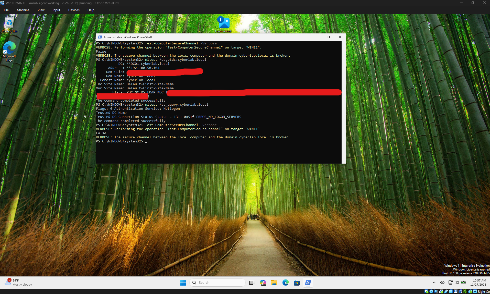
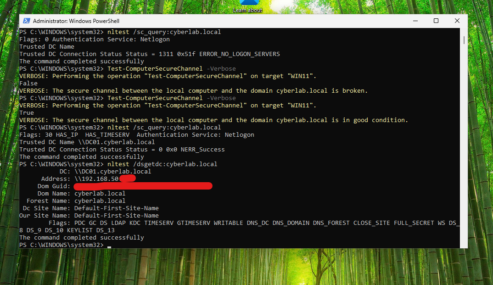

## 1. Active Directory Secure Channel Failure

### Problem Description

The Windows 11 domain-joined workstation experienced a secure channel failure with the Active Directory domain controller. Although the workstation could discover the domain controller, the Netlogon connection was unsuccessful.

### Initial Failure Evidence



### Diagnostic Commands

```powershell
Test-ComputerSecureChannel -Verbose
nltest /dsgetdc:cyberlab.local
nltest /sc_query:cyberlab.local
```

### Identified Symptoms

- Secure channel verification returned False.
- Netlogon returned error 1311 (ERROR_NO_LOGON_SERVERS).
- Domain controller discovery remained successful.

### Remediation

Restarted the Windows Server 2025 domain controller (DC01) and repeated the secure channel and Netlogon verification tests.

The connection recovered without removing or rejoining the workstation to the domain.

### Recovery Evidence



### Verification Results

| Test | Before | After |
|---|---|---|
| Secure Channel | False | True |
| Domain Trust | Broken | Healthy |
| Netlogon | Failed | Successful |
| Connection Status | Error 1311 | NERR_Success |

### Root Cause

The exact root cause was not confirmed. Restarting the domain controller restored connectivity.

### Technical Skills Demonstrated

- Active Directory troubleshooting
- Domain trust diagnostics
- Netlogon troubleshooting
- Windows Server administration
- PowerShell diagnostics
- Incident documentation
- Post-remediation validation

### Incident Status

Resolved at the time of verification. Continue monitoring for recurrence.
