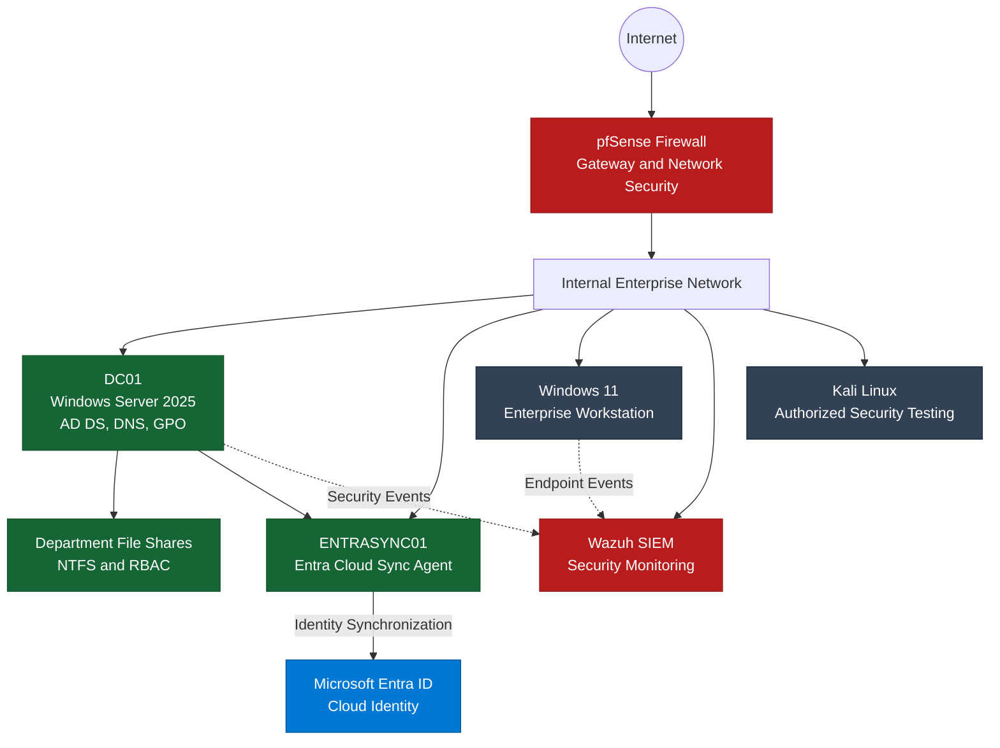

# Zyntra Security — Enterprise Network Architecture

## Overview

This architecture represents an enterprise-style virtual infrastructure designed to demonstrate network security, centralized identity management, hybrid cloud integration, security monitoring, and authorized penetration testing.

## Network Architecture Diagram

## Infrastructure Inventory

| System | Operating System | Primary Function |
|---|---|---|
| pfSense | FreeBSD-based | Firewall and network gateway |
| DC01 | Windows Server 2025 | Active Directory, DNS and Group Policy |
| ENTRASYNC01 | Windows Server 2025 | Hybrid identity synchronization |
| WIN11 | Windows 11 | Enterprise workstation |
| Wazuh Server | Linux | SIEM and security monitoring |
| Kali Linux | Kali Linux | Authorized penetration testing |

## Identity Management

- Centralized Active Directory administration
- 50 simulated employee accounts
- Seven organizational departments
- Role-based access control
- Least-privilege access management
- Microsoft Entra Cloud Sync
- Password hash synchronization

## Security Controls

- Network firewall protection
- Group Policy enforcement
- NTFS access permissions
- Centralized security event collection
- Endpoint security monitoring
- Vulnerability detection
- Privileged account separation

## Virtualization Platform

Oracle VirtualBox

## Security Notice

This infrastructure operates within an authorized homelab environment. Sensitive configuration details and credentials are excluded from public documentation.

## Project Status

Under continuous development.
